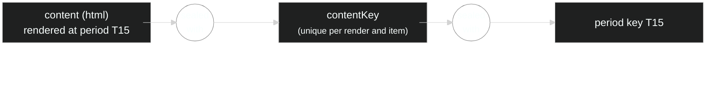
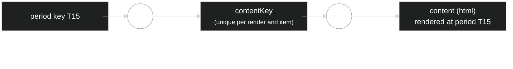
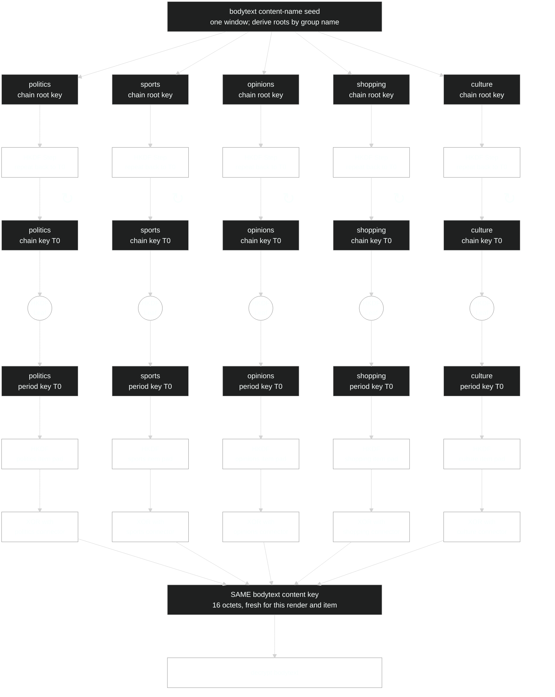

# Key flow: publisher sealing, issuer grants and client opening

Status: Informative Draft

This guide follows key material through the publisher, issuer and client:
what the publisher seals, what the issuer receives and opens, which keys it
returns after authorization, and how the client uses them to open content.

- **Period keys and chain keys:** the issuer opens a sealed root chain key,
  derives an authorized cutoff and returns a chain key or an individual period
  key. The client recovers the item's sealed content key.
- **Content groups:** the issuer opens a sealed content-name seed and derives
  keys for authorized named groups. The client uses a group period key and
  the item's connector to recover its content key.

The ordinary route accompanies [guide--chain-keys.md](guide--chain-keys.md).
The [chain-key profile](spec-profile--chain-keys.md),
[period-key profile](spec-profile--period-keys.md) and
[content-groups proposal](spec-profile--content-groups.md) define the
processing shown here. These diagrams introduce no additional requirements.
They show key handling after the deployment has selected the relevant
profiles. The issuer's required request verification and authorization still
apply; individual validation steps and response protection are not drawn.

## Example and notation

The example uses two independently rooted twelve-hour windows and one-hour
periods, all in UTC. Window B covers today from 12:00 to 24:00; window A covers
tomorrow from 00:00 to 12:00. At 20:10 today, issuer policy permits a cutoff in
period T20. The client opens an article rendered and cached at 15:03, in T15.
`T15` denotes today's 15:00-to-16:00 period; tomorrow's labels belong to window
A. These labels illustrate coordinates, rather than spelling wire values.

Read the chain diagram downward, from later periods to earlier ones. Each
window's root chain key is already its last positioned chain key: T23 in
window B and T11 in window A. **Step** derives the preceding chain key;
**Leaf** derives the period key at the same position. In the ordinary
chain-key example, the publisher supplies both roots in sealed envelopes to the issuer. The issuer opens the selected envelope,
derives backward to its authorized cutoff, T20, and returns that chain key to
the client. In the content-group example, the publisher supplies sealed
content-name seeds instead, and the issuer derives the named group roots.
The next window illustrates a separate root, not an additional client grant.

The Leaf branches show the period keys available at each chain position;
only the keys needed for the operation have to be computed.

The actor column shows who performs the illustrated operation; it does not
imply exclusive possession of a key. The client walk stops at T15 because that
is the item it needs. Its received T20 key can also derive T14, T13 and T12.

The Mermaid diagrams use `block-beta` grids. The text above and below each
diagram also explains the flow for readers whose Markdown renderer does not
display Mermaid.

## Sealing content at publisher

The publisher encrypts each content item under a fresh content key and seals
that key under its access group's period key for the render period. Period
key T15 opens matching content-key seals in the same publisher-scoped family
generation and access group.

Period keys can also be supplied and returned individually, without chains.
They may be generated independently at the publisher; using them requires no
chain derivation at the issuer or client. The chain walk below shows the
optional way to supply and delegate those period keys more compactly. See
[the period-key guide](guide--period-keys.md).

## Chain walk, both windows

```mermaid
%%{init: {"theme": "dark", "themeVariables": {"fontSize": "20px"}, "block": {"padding": 20}}}%%
block-beta
    %% Source layout is intentional: keep it when editing. Blocks are grouped per window with a
    %% comment line before each group; links are grouped per period, blank line between groups,
    %% the step from the previous chain key first and the two Leaf links indented under it.
    %% Mermaid ignores the indentation. A `class` statement must stay on one line.
    columns 16
    %% grid per row: actor 1 | chain key 4 | HKDF leaf 2 | gap 1 | period key 4 | note 4

    %% ===== window A: tomorrow, 00:00 to 12:00, rooted in root chain key A =====
    whoT11["issuer"] chainT11["root chain key A = chain key T11<br/>tomorrow, window 00:00 to 12:00"]:4 leafT11(("HKDF<br/>Leaf")):2 space pkeyT11["period key T11"]:4 space:4
    whoT10["issuer"] chainT10["chain key T10"]:4 leafT10(("HKDF<br/>Leaf")):2 space pkeyT10["period key T10"]:4 space:4
    whoDotsA["issuer"] dotsA(["... T09 to T02 alike, one row each ..."]):4 space:11
    whoT01["issuer"] chainT01["chain key T01"]:4 leafT01(("HKDF<br/>Leaf")):2 space pkeyT01["period key T01"]:4 space:4
    whoT00["issuer"] chainT00["chain key T00, window start"]:4 leafT00(("HKDF<br/>Leaf")):2 space
        pkeyT00["period key T00"]:4 space:4

    space:16

    %% ===== window B: today, 12:00 to 24:00, rooted in root chain key B =====
    %% issuer walks the chain down to T20
    whoT23["issuer"] chainT23["root chain key B = chain key T23<br/>today, window 12:00 to 24:00"]:4 leafT23(("HKDF<br/>Leaf")):2 space pkeyT23["period key T23"]:4
        noteT23["issuer opens the supplied<br/>root chain key at T23"]:4
    whoT22["issuer"] chainT22["chain key T22"]:4 leafT22(("HKDF<br/>Leaf")):2 space pkeyT22["period key T22"]:4
        noteT22["issuer derives chain key T22<br/>from previous chain key T23"]:4
    whoT21["issuer"] chainT21["chain key T21"]:4 leafT21(("HKDF<br/>Leaf")):2 space pkeyT21["period key T21"]:4
        noteT21["issuer derives ..."]:4
    whoT20["issuer"] chainT20["chain key T20"]:4 space
        continues["client continues deriving from here<br/>(policy permits the complete T12 through T20 prefix)"]:4
        space:2
        noteT20["issuer derives ... and stops at chain key T20"]:4
    %% unlock: the issuer hands chain key T20 to the client
    whoUnlock["issuer<br/>to client"] unlock(["unlock response<br/>carries chain key T20"]):4 space:7
        noteUnlock["issuer unlock endpoint hands chain key T20 to client<br/>(grant covers T12 through T20)"]:4
    %% client continues the same walk from its copy of chain key T20
    whoClientT20["client"] clientChainT20["chain key T20"]:4 leafT20(("HKDF<br/>Leaf")):2 space
        pkeyT20["period key T20"]:4
        noteClientT20["client derives period key T20<br/>from the received chain key"]:4
    whoT19["client"] chainT19["chain key T19"]:4 leafT19(("HKDF<br/>Leaf")):2 space pkeyT19["period key T19"]:4
        noteT19["client derives chain key T19<br/>from previous chain key T20 from issuer"]:4
    whoT18["client"] chainT18["chain key T18"]:4 leafT18(("HKDF<br/>Leaf")):2 space pkeyT18["period key T18"]:4
        noteT18["client derives ..."]:4
    whoT17["client"] chainT17["chain key T17"]:4 leafT17(("HKDF<br/>Leaf")):2 space pkeyT17["period key T17"]:4
        noteT17["client derives ..."]:4
    whoT16["client"] chainT16["chain key T16"]:4 leafT16(("HKDF<br/>Leaf")):2 space pkeyT16["period key T16"]:4
        noteT16["client derives ..."]:4
    whoT15["client"] chainT15["chain key T15"]:4 leafT15(("HKDF<br/>Leaf")):2 space pkeyT15["period key T15"]:4
        noteT15["client derives chain key T15 from chain key T16,<br/>then gets period key T15"]:4

    space:16
    %% the article: content key wrapped under period key T15
    whoArticle["client"] space:7
        article["period key T15 opens the content-key seal;<br/>that content key decrypts the item"]:4 space:4

    %% ===== links, window A: each row takes one HKDF step from the row above, then one Leaf =====

        chainT11 --> leafT11
        leafT11 --> pkeyT11

    chainT11 --> chainT10
        chainT10 --> leafT10
        leafT10 --> pkeyT10

    chainT10 --> dotsA

    dotsA --> chainT01
        chainT01 --> leafT01
        leafT01 --> pkeyT01

    chainT01 --> chainT00
        chainT00 --> leafT00
        leafT00 --> pkeyT00

    %% ===== links, window B, issuer side =====

        chainT23 --> leafT23
        leafT23 --> pkeyT23

    chainT23 --> chainT22
        chainT22 --> leafT22
        leafT22 --> pkeyT22

    chainT22 --> chainT21
        chainT21 --> leafT21
        leafT21 --> pkeyT21

    %% issuer stops at chain key T20 and hands it over
    chainT21 --> chainT20
    chainT20 --> continues
    chainT20 --> unlock

    %% ===== links, window B, client side: same walk from the received chain key =====

    unlock --> clientChainT20
        clientChainT20 --> leafT20
        leafT20 --> pkeyT20

    clientChainT20 --> chainT19
        chainT19 --> leafT19
        leafT19 --> pkeyT19

    chainT19 --> chainT18
        chainT18 --> leafT18
        leafT18 --> pkeyT18

    chainT18 --> chainT17
        chainT17 --> leafT17
        leafT17 --> pkeyT17

    chainT17 --> chainT16
        chainT16 --> leafT16
        leafT16 --> pkeyT16

    chainT16 --> chainT15
        chainT15 --> leafT15
        leafT15 --> pkeyT15

    %% the article opens under period key T15
    pkeyT15 --> article

    %% ===== styles =====
    classDef key font-size:22px;
    classDef process fill:none,stroke:#888,color:#aaa;
    classDef note fill:none,stroke:none;
    classDef comment stroke-dasharray:6 4;
    classDef dots fill:none,stroke:#888,stroke-dasharray:6 4,color:#aaa;
    classDef unlock fill:#2b2d31,stroke:#bbb,stroke-width:2px,stroke-dasharray:8 5;
    classDef who fill:none,stroke:none,color:#ddd,font-weight:bold,font-size:22px;
    class chainT20,clientChainT20,pkeyT20,chainT11,chainT10,chainT01,chainT00 key
    class chainT23,chainT22,chainT21,chainT19,chainT18,chainT17,chainT16,chainT15 key
    class pkeyT11,pkeyT10,pkeyT01,pkeyT00,pkeyT23,pkeyT22,pkeyT21 key
    class pkeyT19,pkeyT18,pkeyT17,pkeyT16,pkeyT15 key
    class leafT20,leafT11,leafT10,leafT01,leafT00,leafT23,leafT22 process
    class leafT21,leafT19,leafT18,leafT17,leafT16,leafT15 process
    class noteT20,noteUnlock,noteClientT20,noteT23,noteT22 note
    class noteT21,noteT19,noteT18,noteT17,noteT16,noteT15 note
    class continues,article comment
    class unlock unlock
    class dotsA dots
    class whoDotsA,whoT20,whoUnlock,whoClientT20,whoArticle who
    class whoT11,whoT10,whoT01,whoT00,whoT23,whoT22,whoT21 who
    class whoT19,whoT18,whoT17,whoT16,whoT15 who
```

The issuer returns T20 only after its policy permits that cutoff. Both parties
use the same Step and Leaf construction. The grant reaches back to T12 even
though this illustrated client derives only as far as T15. The separate
window A cannot be reached from any window B chain key.

## Opening content at client

With period key T15 in hand the client unwraps the article's content key, then decrypts the content.

## Grant reach and retained content

The T20 grant covers T12 through T20; the walk from T20 to T15 is only what this
article needs. A cache horizon does not narrow the grant: ciphertext retained
under T12 through T14 stays openable wherever that chain key is still held,
also after entitlement ends; evicting one local copy revokes nothing. The T20
key cannot derive T21 through T23 or any key in window A. See the
[guide's reach explanation](guide--chain-keys.md#reach) and
[client caching guidance](guide--chain-keys.md#client-use-and-caching).

## Content groups

### Issuer receives seeds; client receives group keys

The example uses content name `bodytext` and one chosen content group. The
publisher places a sealed content-name seed for each window in `issuerData`.
The client relays those envelopes to the issuer, which opens them with its
private key. Each recovered seed derives that window's chain roots by group
name; the seed covers only its entrusted content name and window.

The issuer authorizes the chosen group's complete T12-through-T20 prefix in
window B, derives the T20 chain key and returns it. The client continues
backward to T15, the article's render period, derives the period key and recovers the content key
through the item's connector. Window A illustrates a separately supplied
seed and root, not another grant. The reader relays the sealed seed
envelopes but receives neither plaintext seed.

The chain walk uses the same rows and layout as the ordinary example above.

```mermaid
%%{init: {"theme": "dark", "themeVariables": {"fontSize": "20px"}, "block": {"padding": 20}}}%%
block-beta
    %% Source layout is intentional: keep it when editing. Blocks are grouped per window with a
    %% comment line before each group; links are grouped per period, blank line between groups,
    %% the step from the previous chain key first and the two Leaf links indented under it.
    %% Mermaid ignores the indentation. A `class` statement must stay on one line.
    columns 16
    %% grid per row: actor 1 | chain key 4 | HKDF leaf 2 | gap 1 | period key 4 | note 4

    %% ===== window A: tomorrow, 00:00 to 12:00, rooted in root chain key A =====
    whoSupplyA["client<br/>to issuer"] supplyA["sealed seed envelope A<br/>relayed from issuerData"]:4 space:7
        noteSupplyA["issuer opens envelope with its private key"]:4
    whoSeedA["issuer"] seedA["content-name seed A<br/>bodytext, tomorrow's window"]:4 space:7
        noteSeedA["seed recovered from envelope;<br/>HKDF Root with the chosen group name"]:4
    whoT11["issuer"] chainT11["root chain key A = chain key T11<br/>tomorrow, window 00:00 to 12:00"]:4 leafT11(("HKDF<br/>Leaf")):2 space pkeyT11["period key T11"]:4 space:4
    whoT10["issuer"] chainT10["chain key T10"]:4 leafT10(("HKDF<br/>Leaf")):2 space pkeyT10["period key T10"]:4 space:4
    whoDotsA["issuer"] dotsA(["... T09 to T02 alike, one row each ..."]):4 space:11
    whoT01["issuer"] chainT01["chain key T01"]:4 leafT01(("HKDF<br/>Leaf")):2 space pkeyT01["period key T01"]:4 space:4
    whoT00["issuer"] chainT00["chain key T00, window start"]:4 leafT00(("HKDF<br/>Leaf")):2 space
        pkeyT00["period key T00"]:4 space:4

    space:16

    %% ===== window B: today, 12:00 to 24:00, rooted in root chain key B =====
    whoSupplyB["client<br/>to issuer"] supplyB["sealed seed envelope B<br/>relayed from issuerData"]:4 space:7
        noteSupplyB["issuer opens envelope with its private key"]:4
    whoSeedB["issuer"] seedB["content-name seed B<br/>bodytext, today's window"]:4 space:7
        noteSeedB["seed recovered from envelope;<br/>HKDF Root with the chosen group name"]:4
    %% issuer walks the chain down to T20
    whoT23["issuer"] chainT23["root chain key B = chain key T23<br/>today, window 12:00 to 24:00"]:4 leafT23(("HKDF<br/>Leaf")):2 space pkeyT23["period key T23"]:4
        noteT23["issuer derives root chain key T23<br/>from the content-name seed and group name"]:4
    whoT22["issuer"] chainT22["chain key T22"]:4 leafT22(("HKDF<br/>Leaf")):2 space pkeyT22["period key T22"]:4
        noteT22["issuer derives chain key T22<br/>from previous chain key T23"]:4
    whoT21["issuer"] chainT21["chain key T21"]:4 leafT21(("HKDF<br/>Leaf")):2 space pkeyT21["period key T21"]:4
        noteT21["issuer derives ..."]:4
    whoT20["issuer"] chainT20["chain key T20"]:4 space
        continues["client continues deriving from here<br/>(policy permits the complete T12 through T20 prefix)"]:4
        space:2
        noteT20["issuer derives ... and stops at chain key T20"]:4
    %% unlock: the issuer hands chain key T20 to the client
    whoUnlock["issuer<br/>to client"] unlock(["unlock response<br/>carries chain key T20"]):4 space:7
        noteUnlock["issuer unlock endpoint hands chain key T20 to client<br/>(grant covers T12 through T20)"]:4
    %% client continues the same walk from its copy of chain key T20
    whoClientT20["client"] clientChainT20["chain key T20"]:4 leafT20(("HKDF<br/>Leaf")):2 space
        pkeyT20["period key T20"]:4
        noteClientT20["client derives period key T20<br/>from the received chain key"]:4
    whoT19["client"] chainT19["chain key T19"]:4 leafT19(("HKDF<br/>Leaf")):2 space pkeyT19["period key T19"]:4
        noteT19["client derives chain key T19<br/>from previous chain key T20 from issuer"]:4
    whoT18["client"] chainT18["chain key T18"]:4 leafT18(("HKDF<br/>Leaf")):2 space pkeyT18["period key T18"]:4
        noteT18["client derives ..."]:4
    whoT17["client"] chainT17["chain key T17"]:4 leafT17(("HKDF<br/>Leaf")):2 space pkeyT17["period key T17"]:4
        noteT17["client derives ..."]:4
    whoT16["client"] chainT16["chain key T16"]:4 leafT16(("HKDF<br/>Leaf")):2 space pkeyT16["period key T16"]:4
        noteT16["client derives ..."]:4
    whoT15["client"] chainT15["chain key T15"]:4 leafT15(("HKDF<br/>Leaf")):2 space pkeyT15["period key T15"]:4
        noteT15["client derives chain key T15 from chain key T16,<br/>then gets period key T15"]:4

    space:16
    %% item opening: period-key column continues through pad and connector
    whoPad["client"] space:7 pad["HKDF item pad<br/>secret input: period key T15"]:4
        notePad["context: renderId + contentName (bodytext)<br/>fixed connector salt and item-pad label"]:4
    whoXor["client"] space:7 xor["item pad XOR connector"]:4
        noteXor["connector carried by this bodytext item<br/>under the chosen group name"]:4
    whoCkey["client"] space:7 ckey["bodytext content key<br/>fresh for this render and item"]:4
        noteCkey["same key recovered through any other<br/>authored connector for this item"]:4
    whoContent["client"] space:7 content["decrypt bodytext"]:4
        noteContent["the recovered key opens<br/>this rendered bodytext item"]:4

    %% ===== each window's seed derives its named group root =====
    supplyA --> seedA
    seedA --> chainT11
    supplyB --> seedB
    seedB --> chainT23

    %% ===== links, window A: each row takes one HKDF step from the row above, then one Leaf =====

        chainT11 --> leafT11
        leafT11 --> pkeyT11

    chainT11 --> chainT10
        chainT10 --> leafT10
        leafT10 --> pkeyT10

    chainT10 --> dotsA

    dotsA --> chainT01
        chainT01 --> leafT01
        leafT01 --> pkeyT01

    chainT01 --> chainT00
        chainT00 --> leafT00
        leafT00 --> pkeyT00

    %% ===== links, window B, issuer side =====

        chainT23 --> leafT23
        leafT23 --> pkeyT23

    chainT23 --> chainT22
        chainT22 --> leafT22
        leafT22 --> pkeyT22

    chainT22 --> chainT21
        chainT21 --> leafT21
        leafT21 --> pkeyT21

    %% issuer stops at chain key T20 and hands it over
    chainT21 --> chainT20
    chainT20 --> continues
    chainT20 --> unlock

    %% ===== links, window B, client side: same walk from the received chain key =====

    unlock --> clientChainT20
        clientChainT20 --> leafT20
        leafT20 --> pkeyT20

    clientChainT20 --> chainT19
        chainT19 --> leafT19
        leafT19 --> pkeyT19

    chainT19 --> chainT18
        chainT18 --> leafT18
        leafT18 --> pkeyT18

    chainT18 --> chainT17
        chainT17 --> leafT17
        leafT17 --> pkeyT17

    chainT17 --> chainT16
        chainT16 --> leafT16
        leafT16 --> pkeyT16

    chainT16 --> chainT15
        chainT15 --> leafT15
        leafT15 --> pkeyT15

    %% period key derives the item pad; the connector recovers the content key
    pkeyT15 --> pad
    pad --> xor
    xor --> ckey
    ckey --> content

    %% ===== styles =====
    classDef key font-size:22px;
    classDef process fill:none,stroke:#888,color:#aaa;
    classDef note fill:none,stroke:none;
    classDef comment stroke-dasharray:6 4;
    classDef dots fill:none,stroke:#888,stroke-dasharray:6 4,color:#aaa;
    classDef unlock fill:#2b2d31,stroke:#bbb,stroke-width:2px,stroke-dasharray:8 5;
    classDef who fill:none,stroke:none,color:#ddd,font-weight:bold,font-size:22px;
    class chainT20,clientChainT20,pkeyT20,chainT11,chainT10,chainT01,chainT00 key
    class chainT23,chainT22,chainT21,chainT19,chainT18,chainT17,chainT16,chainT15 key
    class pkeyT11,pkeyT10,pkeyT01,pkeyT00,pkeyT23,pkeyT22,pkeyT21 key
    class pkeyT19,pkeyT18,pkeyT17,pkeyT16,pkeyT15 key
    class leafT20,leafT11,leafT10,leafT01,leafT00,leafT23,leafT22 process
    class leafT21,leafT19,leafT18,leafT17,leafT16,leafT15 process
    class noteT20,noteUnlock,noteClientT20,noteT23,noteT22 note
    class noteT21,noteT19,noteT18,noteT17,noteT16,noteT15 note
    class continues comment
    class unlock unlock
    class dotsA dots
    class whoDotsA,whoT20,whoUnlock,whoClientT20 who
    class whoT11,whoT10,whoT01,whoT00,whoT23,whoT22,whoT21 who
    class whoT19,whoT18,whoT17,whoT16,whoT15 who
    class whoSupplyA,whoSupplyB who
    class noteSupplyA,noteSupplyB note
    class supplyA,supplyB unlock
    class seedA,seedB,ckey key
    class pad,xor,content process
    class noteSeedA,noteSeedB,notePad,noteXor,noteCkey,noteContent note
    class whoSeedA,whoSeedB,whoPad,whoXor,whoCkey,whoContent who
```

A period-key-only grant is also possible: instead of returning the T20 chain
key, the issuer continues to T15, performs Leaf there and returns only the
period key T15. The client enters at that period key and performs
only the final pad, XOR and content-opening steps. A period key derives no
other chain key or period key; it remains reusable for matching items at that
content-name, group, window and period coordinate. A chain key grants its
whole backward prefix, not only the period this article needs.

### Five content groups, one content key

This `bodytext` item has connectors for `politics`, `sports`, `opinions`,
`shopping` and `culture`. One content-name seed for `bodytext` and one window
in the publisher's namespace derives all five roots by group name. No group
tree or catalogue is needed.

Each abbreviated walk reaches its group's chain key at the resource's render
period, called **T0** here (T15 in the preceding example). T0 is a relative
label for this diagram, not the window start or a wire spelling. HKDF Leaf
derives the period key from the chain key at T0. A period key cannot derive
other chain or period keys.

In this example the issuer returns a chain key at the authorized cutoff, as
shown in the preceding detailed walk. An issuer can also return a root chain
key when its policy authorizes the entire window, or an individual period
key when only that period is authorized. It never returns the content-name
seed to the reader through this route. The loops repeat HKDF Step, producing
an earlier chain key each time until T0 is reached; the handoff is abbreviated.

All five routes are shown for comparison; **any one route is sufficient**.
Each pad uses its group's period key and the same item context, `renderId`
and `contentName` (`bodytext`), under the fixed connector salt and label.
Each pad XOR its corresponding connector recovers the same fresh content key.

For each group, the publisher computes `connector = itemPad XOR contentKey`;
the client computes `contentKey = itemPad XOR connector`. Each pad and
connector is 16 octets. The connectors are carried by the item; they do not
require the client to obtain another group's key.

These content-group period keys have the same one-period role as ordinary
period keys, but their key material and scope are distinct. A content-group
period key is also specific to its content name and window, and its route to
the content key uses a connector rather than an ordinary content-key seal.
